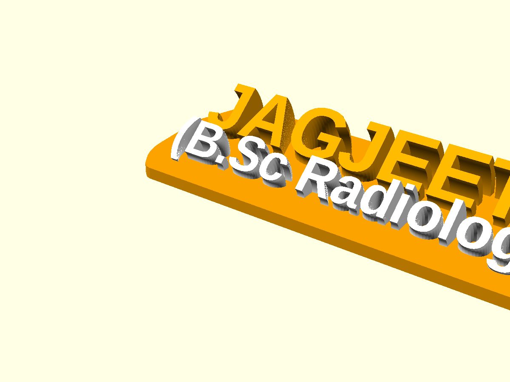
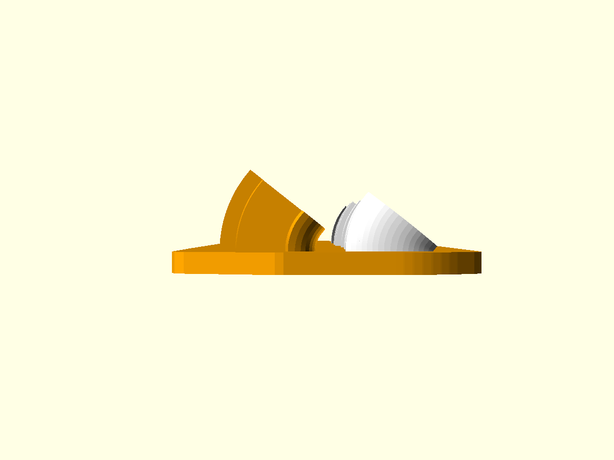
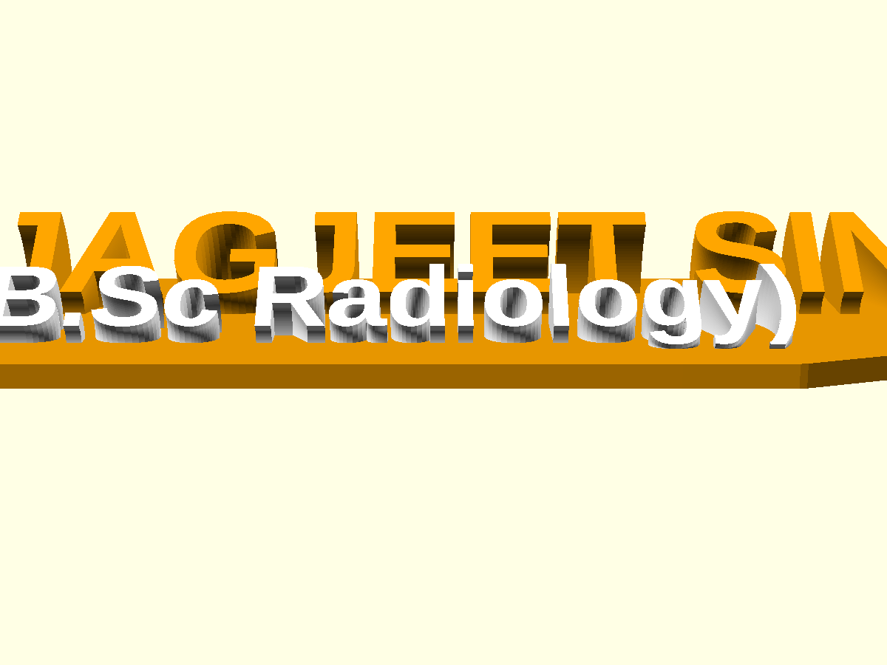
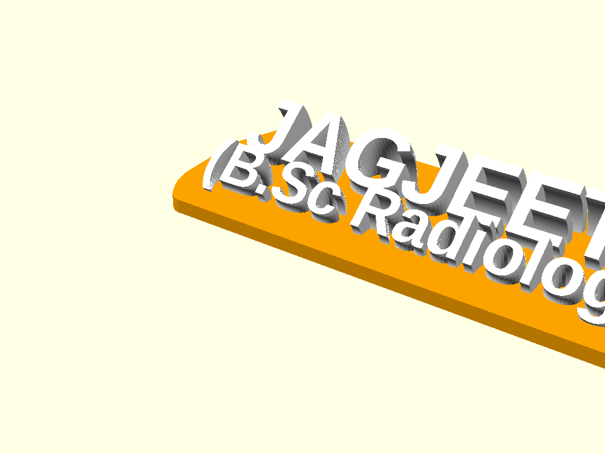
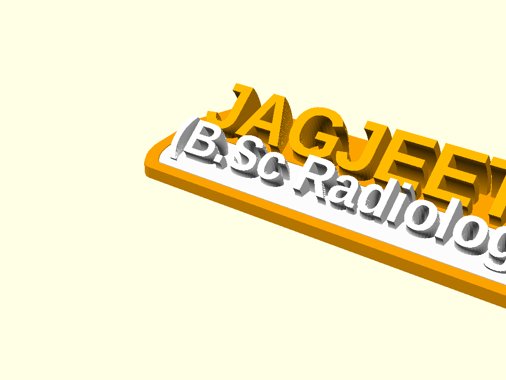

# 3D Parametric Curved Desk Name Plate 🏷️

[](https://openscad.org/)
[-green.svg)](https://bambulab.com/en/a1-mini)
[]()
[](https://opensource.org/licenses/MIT)

A parametric, 3D-printable desk name plate featuring an ergonomic curved design. Both the upper name and lower designation texts curve forward toward the viewer by **40°**, allowing seated desk visitors and colleagues to read the plate upright while it lies flat on the desk.

Includes out-of-the-box workflows for **Bambu Lab AMS / Multi-Material**, **Non-AMS Manual Filament Swaps (Pause at Layer)**, and **Modular Inlay Assembly**, with automatic sizing designed to fit comfortably on compact print beds like the **Bambu Lab A1 Mini (180 × 180 mm)**.

---

## 🌐 Interactive Web Customizer

Try the interactive 3D Web Customizer directly in your browser:  
👉 **[Launch Live Web Customizer](https://tumesh007.github.io/3d-desk-name-plate/)**

- **Live 3D Preview**: Real-time rendering with interactive orbit controls and color palettes.
- **A1 Mini Bed Visualizer**: Real-time bounding box checking against 180×180 mm and diagonal 245 mm limits.
- **Auto-Fit Button**: Automatically scales font size down to fit any custom name safely onto the bed.
- **One-Click Export**: Export ready-to-print STLs or custom `.scad` script files directly.
- **No Software Required**: Customize and export right from Chrome, Firefox, Safari, or Edge.

---

## 📸 Geometry & Renders

| Isometric View | Side View (40° Ergonomic Lean) | Seated Desk Perspective |
| :---: | :---: | :---: |
|  |  |  |

---

## ✨ Key Features

1. **Ergonomic Faceted Arc Bend**:
   - Replaces vertical text with an arc of $N=24$ slices rotated around the front hinge edge.
   - Leans toward the viewer by $40^\circ$ from vertical ($50^\circ$ above the desk plane).
   - Slices overlap by $\ge 0.47\text{ mm}$ (strictly exceeding the $0.2\text{ mm}$ minimum), ensuring a solid, watertight manifold with zero non-manifold edges.

2. **100% Support-Free Printing**:
   - Maximum overhang angle is strictly $40^\circ \le 45^\circ$.
   - Prints cleanly without any support material, saving filament and post-processing cleanup.

3. **Compact Bed Optimization (Bambu Lab A1 Mini)**:
   - Default dimensions: **162 mm × 37 mm × 14 mm** — perfectly fits the $180 \times 180\text{ mm}$ A1 Mini bed with $9\text{ mm}$ safety clearance on each side.
   - For extra-long names, enable `print_diagonal = true` (or toggle Diagonal in the web app) to fit names up to **245 mm** along the bed diagonal.

---

## 🖨️ Printing Methods: AMS vs. Non-AMS

| Method | Printer Type | Color Changes | Setup Difficulty |
| :--- | :--- | :--- | :--- |
| **1. Dual-Material (AMS)** | Bambu AMS, Prusa MMU, IDEX | Automated per-layer | Easiest (Single click) |
| **2. Layer-Pause (`M600`)** | Any single-extruder (A1 Mini, Ender 3, etc.) | 1 manual filament swap | Easy (Zero hardware needed) |
| **3. Inlay Snap Assembly** | Any single-extruder | 2 independent prints | Easy (Modular snap-fit) |

---

### Method 1: Dual-Material / AMS Multi-Color (Recommended for AMS)
Exported parts:
- `color.stl`: Base plate + upper Name text (Filament 1, e.g. Orange or Charcoal)
- `white.stl`: Lower curved Designation text (Filament 2, e.g. White or Gold)

**Slicing Steps**:
1. Open **Bambu Studio** or **OrcaSlicer**.
2. Select both `color.stl` and `white.stl` simultaneously and drag them into the slicer.
3. When prompted: *"Load these files as a single object with multiple parts?"*, click **YES**.
4. Assign Filament Slot 1 to `color` and Filament Slot 2 to `white`.
5. Slice and print!

---

### Method 2: Non-AMS Single Extruder (Manual Layer Pause)
No multi-material hardware required! Prints as a single solid piece with **one single filament swap**:
- Base plate thickness is $3.0\text{ mm}$.
- All raised text starts at $Z = 3.0\text{ mm}$.



**Slicing Steps**:
1. In `plate.scad`, set `part = "layer_pause";` (or select *Layer Pause* in the Web Customizer).
2. Export `nameplate_layer_pause.stl` and open in your slicer.
3. Slice at **0.20 mm layer height**.
4. Move the layer preview slider to **Layer 15 ($Z = 3.0\text{ mm}$)**.
5. Right-click the layer scrollbar and choose **"Add Pause"** (or `M600` Filament Change).
6. Start print with Base filament (e.g., Black/Orange).
7. At $Z = 3.0\text{ mm}$, the printer automatically parks the head and beeps. Swap filament to Text color (e.g., White).
8. Press Resume — the letters print cleanly in the new color!

---

### Method 3: Non-AMS Modular Inlay Assembly
Print the components as separate modular pieces and snap them together:
- `assembly_base.stl`: Base plate with a $1.0\text{ mm}$ deep recessed mating pocket.
- `assembly_insert.stl`: Curved designation text with an integral $1.0\text{ mm}$ mounting tab.



**Slicing Steps**:
1. In `plate.scad`, set `part = "assembly_base";` and export the base STL. Print in Color 1.
2. In `plate.scad`, set `part = "assembly_insert";` and export the insert STL. Print in Color 2.
3. Built-in $0.25\text{ mm}$ clearance tolerance ensures a snug friction fit. Apply a drop of CA/superglue if desired for permanent bonding.

---

## ⚙️ Slicer Settings Recommendations

| Parameter | Recommended Value | Reason |
| :--- | :--- | :--- |
| **Layer Height** | `0.16 mm` (or `0.20 mm`) | Finer layer height produces ultra-smooth facet transitions on the curved text |
| **Wall Loops** | `3` | Ensures strong perimeters on thin letter stems |
| **Top/Bottom Shells**| `4` | Completely hides infill on the flat base plate |
| **Infill** | `15%` Gyroid or Grid | Adequate rigidity with minimal filament usage |
| **Supports** | **DISABLED (None)** | 100% support-free design ($40^\circ$ maximum overhang) |
| **Brim** | Auto / Mouse-ears | Optional; helps prevent corner lifting on sharp plate edges |

---

## 🛠️ OpenSCAD Parameters

You can customize the design locally using OpenSCAD:

```openscad
/* [Text & Typography] */
name            = "JAGJEET SINGH";  // Upper line text
desig           = "(B.Sc Radiology)";// Lower line text
fnt             = "Liberation Sans:style=Bold";
name_size       = 14;               // mm (fits A1 Mini bed <= 175mm)
desig_size      = 9.5;              // mm

/* [Curved Bend Geometry] */
slant_name      = true;             // Apply 40° curve to Name text
bend_deg        = 40;               // Forward lean angle (degrees)
slices          = 24;               // Arc facet slices
slice_t         = 0.85;             // Thickness per slice (overlap >= 0.47mm)

/* [Printing Mode] */
part            = "dual_material";  // Options: "dual_material", "layer_pause", "assembly_base", "assembly_insert"
print_diagonal  = false;            // Rotate 45° for extra-long names
```

### Headless CLI Export Examples:

```bash
# Export dual-material STLs
openscad -o color.stl -D "part=\"color\"" plate.scad
openscad -o white.stl -D "part=\"white\"" plate.scad

# Export Non-AMS layer-pause single STL
openscad -o nameplate_layer_pause.stl -D "part=\"layer_pause\"" plate.scad

# Export Non-AMS modular assembly parts
openscad -o base_inlay_recessed.stl -D "part=\"assembly_base\"" plate.scad
openscad -o designation_insert.stl -D "part=\"assembly_insert\"" plate.scad
```

---

## 📄 License

This project is licensed under the [MIT License](LICENSE) — free to use, modify, and distribute for both personal and commercial 3D printing.
